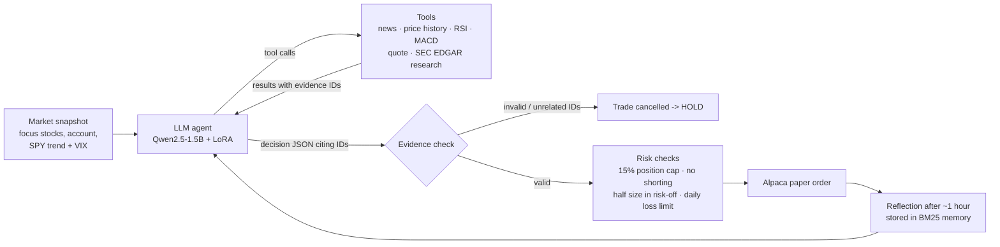

# Evidence-Grounded LLM Trading Agent

An LLM stock-trading agent that **must cite real, dated evidence for every trade**. A small language model (Qwen2.5-1.5B-Instruct, LoRA fine-tuned) researches stocks with tools — news, price indicators, SEC EDGAR filings and market regime — and proposes trades that reference evidence IDs. Python code verifies each citation and applies risk limits before any order reaches the Alpaca paper-trading API. Trades the model cannot support with evidence are cancelled.

Course project, Worcester Polytechnic Institute, Fall 2026. Built on a course-provided starter notebook; the additions are described below. Paper trading only — no real money.

---

## How it works

1. **Research.** Every decision starts with a snapshot of 10 liquid stocks. Stocks with a large price move (>2 std) or an earnings release (SEC 8-K item 2.02) in the last 5 days are marked *research needed*. The model then calls tools (up to 4 per decision).
2. **Evidence IDs.** Every fact a tool returns is tagged, e.g. `[N-62779242]` (news article), `[R-NVDA]` (RSI), `[S-AAPL-1]` (SEC filing), `[F-AAPL-EPS]` (quarterly EPS vs. last year), `[M-SPY]` (market).
3. **Verification.** The model must cite IDs for each buy/sell. A trade is kept only if at least one cited ID appeared in this conversation *and* refers to that stock; otherwise it becomes HOLD.
4. **Risk manager.** Caps quantity and position size, forbids short selling, halves trades in a risk-off market, and blocks new buys after a 3% intraday drawdown.
5. **Memory.** About an hour after a trade, the model writes a one-sentence lesson (stock, action, gain/loss, whether the evidence helped). Relevant lessons are retrieved with BM25 and added to later prompts.

### No look-ahead in backtests
Every tool takes a `date` argument. In a backtest it only returns data available on that day: prices cut at the date, news published before 20:00 UTC, SEC filings filed before the date. The tool dispatcher also ignores any date the model invents.

### Training
- **Data:** the base model trades 40 historical days (point-in-time data); each day is labelled by the **3-day forward return** of the traded stocks with a **0.5% no-trade band** (good / corrected / bad / neutral).
- **Held-out test:** the most recent 20 days are never used for training.
- **LoRA SFT:** r = 8, alpha = 16 on `q_proj`/`v_proj`, loss on the assistant's tool-call turns and final decision only, 2 epochs.

---

## Results

### Backtests (held-out 20 trading days, Oct 6 – Nov 2, 2026)

| Agent | Return | Days with trades | Trades blocked as unsupported |
|---|---|---|---|
| Base model | −3.28% | 13 / 20 | 8 |
| **Fine-tuned (final)** | **−2.76%** | **18 / 20** | **2** |
| First fine-tune attempt | 0.00% (no trades) | 0 / 20 | 20 |
| Buy-and-hold SPY | −2.63% | – | – |

Fine-tuning mainly improved *behaviour*: the agent cited valid evidence far more reliably and traded on more days. Return differences over 20 days in a falling market are within noise.

**Debugging a failed fine-tune.** The first LoRA run trained only on the final decision; with 15 examples the model overfitted (loss 0.20), stopped emitting `<tool_call>` tags and invented evidence IDs, so every trade was blocked. Training on the tool-call turns as well, with fewer epochs and a lower learning rate, fixed it (0 → 18 active days).

**Ablation — research + verification off vs. on** (base model, same days and seeds): return −0.65% → −3.28%, unsupported trades blocked 0 → 8. Verification made every executed trade traceable to a source; it did not improve short-term return.

### Live paper trading (Nov 9–13, 2026, ~4 hours per day)

| Metric | Value |
|---|---|
| Decision loops | 374 (no crashes) |
| Orders submitted | 312 (223 buy, 89 sell) |
| Trades cancelled for missing / invalid evidence | 79 |
| Reflections written to memory | 238 |
| Account return over the week | about −0.6% (SPY about +0.7%) |

Full daily logs are in [`logs/live_week/`](logs/live_week/).

### Limitations (honest assessment)
- **Over-trading:** the inherited prompt requires at least one trade per decision, so the agent traded every ~2–3 minutes.
- **Concentration:** 58% of orders were NVIDIA, which fell during the live week.
- **Small model:** reasons are often shallow, and the agent relied mostly on one tool (SEC research).
- **Small training set:** 15 labelled days; one week and 20-day backtests are too short to measure trading skill.

The contribution is **reliability and auditability** of LLM trading decisions, not higher returns.

---

## Repository contents

| Path | Contents |
|---|---|
| `trading_agent.ipynb` | Full pipeline with outputs: tools, agent loop, memory, backtests, LoRA training, live loop. The top cell lists every change to the starter framework. |
| `lora_adapter/` | Trained LoRA adapter for `Qwen/Qwen2.5-1.5B-Instruct` |
| `logs/live_week/` | Automatic logs of the five live trading days |
| `requirements.txt`, `.env.example` | Setup |

## Running it

1. Create an environment (Python 3.11), install PyTorch for your GPU, then `pip install -r requirements.txt`.
2. Copy `.env.example` to `.env` next to the notebook and add your **paper** Alpaca keys, a free Alpha Vantage key and a SEC user-agent string.
3. To use the trained adapter without retraining, copy `lora_adapter/` to `stock_agent_cache/lora_adapter/`.
4. Open `trading_agent.ipynb` in Jupyter and run the setup cells, Tasks 2–3, then the Task 5 loop. Sections 4a–4c rerun the backtest and training.

Tested on Windows 11 with an NVIDIA RTX 5070 laptop GPU (8 GB).

## Tech stack
Python · PyTorch · Hugging Face Transformers · PEFT (LoRA) · rank-bm25 · Alpaca API · yfinance · Alpha Vantage · SEC EDGAR API

## Disclaimer
Educational project. Paper trading only. Not financial advice.
